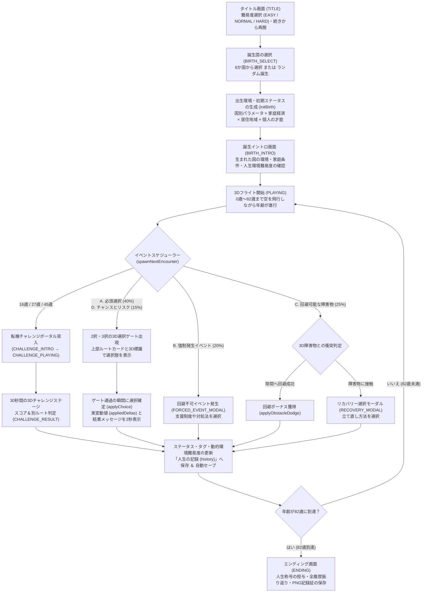

# SKY LIFE — 空飛ぶ人生ゲーム

**「あなたは、どんな人生を飛ぶ？」**

**SKY LIFE — 空飛ぶ人生ゲーム** は、プレイヤーが世界のどこかの国に赤ん坊（0歳）として生まれ、3Dの空を飛びながら82歳までの人生の選択・転機・困難を経験し、自分だけの人生を歩む **3Dフライト型・社会環境＆人生シミュレーションゲーム** です。  
生まれた国や家庭環境によって異なる「構造的なハードル」や「社会の支援制度」の中で、数値の損得だけではなく自分の価値観でルートを選び、世界に一つだけの人生の軌跡を描きます。

- 🌐 **公開Webアプリ（GitHub Pages）**: https://sh0zy.github.io/sky-life/
- 💻 **GitHubリポジトリ**: https://github.com/sh0zy/sky-life

---

## 目次

1. [開発の背景・込めた思い](#1-開発の背景込めた思い)
2. [ゲームの特徴（実装済み機能）](#2-ゲームの特徴実装済み機能)
3. [ゲームの操作方法](#3-ゲームの操作方法)
4. [これまでの課題と改善内容（開発エンジニアリング記録）](#4-これまでの課題と改善内容開発エンジニアリング記録)
   - [改善①：ステータスが100でカンストする問題](#改善ステータスが100でカンストする問題)
   - [改善②：マイナスの選択肢を簡単に回避できる問題](#改善マイナスの選択肢を簡単に回避できる問題)
   - [改善③：イベント発生比率の調整](#改善イベント発生比率の調整)
   - [改善④：国による人生難易度の違いと国別データの根拠](#改善国による人生難易度の違いと国別データの根拠)
   - [改善⑤：スマホ版のステータスUIが視界を隠す問題](#改善スマホ版のステータスuiが視界を隠す問題)
   - [改善⑥：スマホの移動範囲が広すぎる問題](#改善スマホの移動範囲が広すぎる問題)
   - [改善⑦：選択前のステータス表示による「数値損得選び」の問題](#改善選択前のステータス表示による数値損得選びの問題)
   - [改善⑧：選択肢が重なって読めない問題](#改善選択肢が重なって読めない問題)
   - [改善⑨：PCとスマホのUI分離・PC版ステータスUIの復元](#改善pcとスマホのui分離pc版ステータスuiの復元)
5. [技術構成](#5-技術構成)
6. [システムの設計と処理の流れ](#6-システムの設計と処理の流れ)
7. [起動方法・ビルド方法](#7-起動方法ビルド方法)
8. [今後の改善予定](#8-今後の改善予定)

---

## 1. 開発の背景・込めた思い

### 「人生には正解が一つだけではない」

人生は、勉強、進学、就職、仕事、人間関係、家族、健康、趣味など、無数の選択の積み重ねで形づくられます。  
しかし現実の人生は、個人の努力や才能だけで決まるものではありません。**生まれた国、家庭の経済状況、居住地域、教育や医療へのアクセス、そして予期せぬ病気や景気変動など、自分では選べない環境要因** にも大きく影響されます。

例えば「大学に進学する」「専門職に就く」という同じ目標であっても、教育費の負担や奨学金制度、地域のインフラによって必要な準備やハードルの高さは大きく異なります。

本作『SKY LIFE』を開発するにあたり、私たちは次の2つの思想を核に据えました。

1. **「生まれる環境は選べないが、その環境の中でどのように人生を歩むかは選択できる」**  
   国や家庭環境の優劣を決めるのではなく、それぞれの社会環境にある課題と、それを乗り越えるための「公的支援制度（奨学金・職業訓練・社会保障など）」「周囲との支え合い」「個人の工夫と選択」をゲーム体験として描くこと。
2. **「単純な成功・失敗やスコアの高さだけで人生を評価しない」**  
   裕福な環境で才能を伸ばす人生も、厳しい環境から奨学金や技術を武器に道を切り拓く人生も、人との温かなつながりや心の平穏を大切にする人生も、すべて等しく価値あるものとして肯定できるエンディングを届けること。

数値の損得計算ではなく、「自分ならこの瞬間どう生きるか」を考えながら空を飛ぶ体験を目指しています。

---

## 2. ゲームの特徴（実装済み機能）

ソースコード（`src/`）に実装され、現在動作する主な機能は以下の通りです。

### ✈️ 3D空間を飛行しながら進む5つの人生ステージ（0歳〜82歳）
- プレイヤーは3D空間の空を飛びながら年齢を重ね、ライフステージに応じた5つのチャプターを進みます。
  - **Chapter 1（0〜6歳）**: 幼少期 — はじまりの空
  - **Chapter 2（7〜17歳）**: 子ども・学生時代 — 学びと友の風
  - **Chapter 3（18〜29歳）**: 青年期 — 旅立ちと選択の気流
  - **Chapter 4（30〜59歳）**: 大人・成熟期 — 荒波と挑戦の大空
  - **Chapter 5（60〜82歳）**: シニア期〜エンディング — 黄金の夕焼け空
- 年齢とチャプターの進行に合わせて、空の色彩・ライティング・プレイヤーキャラクターの頭身や造形が動的に変化します（`SkyEnvironment.tsx`、`PlayerCharacter.tsx`）。

### 🚪 前方から迫る人生の選択ゲートと4種類のイベント体系
飛行中、前方から以下の4カテゴリのイベントが出現します（`MainFlightDirector.tsx`、`gameData.ts`）。
1. **A. 必須選択ゲート（`mandatory`）**: 2択または3択のゲート。どの選択肢にもメリットと代償（トレードオフ）があり、自分の価値観でルートを選びます。
2. **B. 強制発生イベント（`forced_event`）**: 景気変動やライフステージ上の避けられない転機。接触時に飛行が一時停止し、公的支援制度の活用や対処方針を選択します。
3. **C. 回避可能な3D障害物（`avoidable_obstacle`）**: 病気・出費・人間関係の摩擦などを象徴する3D障害物。飛行操作で隙間を縫って回避するとボーナスが得られ、接触した場合はリカバリー選択モーダルで立て直しを図ります。
4. **D. チャンスとリスク（`chance_risk`）**: 起業・コンクール・海外挑戦など、これまでの知識・スキル・準備タグ・社会環境に応じて成功確率（26%〜89%）が変動する挑戦イベントです。

### 📊 上限なしで成長・変動する7つの人生ステータス
以下の7つのステータスが人生の状態を表現します（`statSystem.ts`）。
- **状態・環境ステータス（`condition`）**: **幸福度** / **健康** / **お金** / **人間関係**
- **累積成長ステータス（`cumulative`）**: **知識・スキル** / **自己実現** / **レジリエンス（精神的回復力）**
- 100でカンストせず、100 → 250 → 500 → 1,000 → 10,000以上へと多段階ティア（`Lv.1`, `Lv.2`...）で成長し続けます。

### 🔥 人生の3大転機「特別チャレンジステージ」
特定の年齢に到達すると、通常フライトから30秒間の専用ミニゲームステージへ突入します（`ChallengeStageDirector.tsx`）。
- **16歳頃**: 受験・進学チャレンジ（知識ゲート・奨学金支援ゲート・誘惑障害物が登場）
- **27歳頃**: 就職・キャリアチャレンジ（資格・スキル開放ゲートや転居・新市場ゲートが登場）
- **45歳頃**: 人生の岐路・挑戦チャレンジ（起業・社会保障活用・地域貢献ゲートが登場）
- 生まれた国や家庭環境、事前準備（奨学金獲得・学習習慣・資格取得など）によって初期スコアや突破ルートが変化し、仮に目標スコアに届かなくても「別ルート（公立・職業訓練・地域共創など）」として人生が前向きに続く設計になっています。

### 🌍 生まれた国・家庭環境による社会環境シミュレーション
- **日本・アメリカ・ブラジル・インド・ケニア・フランス** の6か国からランダムまたは任意で誕生します（`socialSimulation.ts`）。
- 国ごとの社会環境パラメータ（教育・医療・雇用・社会保障・地域格差など）と、家庭の経済状況・居住地域・家庭支援を組み合わせて **「人生環境の難易度（0〜100）」** を動的に算出します。
- 個人の才能・得意分野・知的好奇心は、生まれた国や貧富の差に一切左右されず完全に平等な確率で付与されます。

### 🏆 選択履歴を反映した多様なエンディングと「人生の記録証」出力
- 82歳に到達すると、最終ステータス・初期と最終の環境難易度・選択履歴・利用した支援制度・乗り越えた困難を振り返るエンディング画面へ進みます（`EndingScreen.tsx`）。
- 高スコアや逆境克服だけを称賛するのではなく、人との絆、表現、調和、探究心など多様な生き方を讃える称号（14種類以上）が授与され、HTML5 Canvas によって **「人生の記録証（PNG画像）」** を端末へダウンロード保存できます。

---

## 3. ゲームの操作方法

現在のコード（`src/components/ui/FlightControls.tsx`、`src/components/ui/HUD.tsx`）に実装されている操作方法です。

### 💻 PC版

| 操作 | キー / 入力方法 | 機能・説明 |
| :--- | :--- | :--- |
| **上昇** | `W` または `↑`（上矢印） | プレイヤーが上方向へ飛行移動します |
| **下降** | `S` または `↓`（下矢印） | プレイヤーが下方向へ飛行移動します |
| **左移動** | `A` または `←`（左矢印） | 左側のルート・選択ゲートへ移動します |
| **右移動** | `D` または `→`（右矢印） | 右側のルート・選択ゲートへ移動します |
| **加速（ブースト）** | `Space` キー長押し（または画面右下の加速ボタン） | 飛行速度と年齢進行速度がアップします |
| **ポーズ / 設定** | `Esc` キー（または画面右上のポーズボタン） | ゲームを一時停止し、設定・デバッグ・選択履歴を開きます |
| **ポインター操作** | 画面左下のバーチャルパッドをマウスドラッグ | キーボードだけでなくマウス・タッチドラッグでも移動可能です |
| **社会環境パネル** | 画面上部の「社会環境」または難易度バッジをクリック | 現在の国別パラメータ・出生条件・利用した支援制度を確認します |
| **人生の記録** | 画面右上の「人生の記録」ボタンをクリック | ステータス詳細とこれまでの全選択履歴を確認します |

### 📱 スマートフォン版（縦画面・横画面対応）

| 操作UI | 配置場所 | 機能・説明 |
| :--- | :--- | :--- |
| **バーチャルジョイスティック** | 画面左下 | タッチ＆ドラッグで上下左右360度に滑らかに飛行移動します（デッドゾーン10%・感度調整対応） |
| **加速（ブースト）ボタン** | 画面右下 | タッチしている間、高速飛行（ブースト）します。左手のジョイスティックとの**同時マルチタッチ（Pointer Events API）**に対応しています |
| **ステータス確認ボタン（`📊`）** | 画面右上（左側のアイコン） | タップするとゲームが自動一時停止し、**「人生ステータス・成長の記録」モーダル**が開きます。閉じるとプレイが再開します |
| **ポーズボタン（`⏸`）** | 画面右上（右側のアイコン） | ゲームを一時停止し、タッチ移動感度スライダーやイベント比率・国別パラメータ設定画面を開きます |
| **選択肢の選択** | 飛行ルート移動（またはモーダルタップ） | 通常選択は入りたいゲート（①左 / ②中央 / ③右）へ機体を移動させて通過します。強制イベント時は選択肢カードをタップします |

---

## 4. これまでの課題と改善内容（開発エンジニアリング記録）

本作の開発過程で直面した9つの主要な課題と、それに対する原因分析・設計思想・具体的なコード実装・検証結果を以下に記録します。

---

### 改善①：ステータスが100でカンストする問題

- **発生した問題**  
  開発初期の仕様では、幸福度や知識などの各ステータスが `0〜100` の範囲に固定されていたため、ゲーム中盤（20代〜30代）で数値が `100` に到達すると、それ以降の選択でステータスが一切増加しなくなる問題がありました。
- **問題が起きた原因**  
  ステータス更新処理で単純な上限クランプ（`Math.min(100, val + delta)`）を行っており、長期的な人生シミュレーションにおける後半の成長余地や、累積的なスキル蓄積と一時的なコンディション変動の違いが考慮されていなかったためです。
- **改善するために考えたこと**  
  1. `100` の上限を撤廃し、100、500、1,000、10,000以上へと際限なく成長できるようにする。
  2. ステータスを **「累積成長型（知識・スキル、自己実現、レジリエンス）」** と **「状態変動型（幸福度、健康、お金、人間関係）」** の2カテゴリに分離する。
  3. 数値が高くなるほど1回あたりの上昇量が緩やかになる「収穫逓減（Diminishing Returns）曲線」と、逆に高ステータス時に慢心や過労でダメージを受けた際の「脆弱性スケーリング」を導入し、後半でも選択の緊張感を維持する。
- **実施した修正（`src/utils/statSystem.ts`）**  
  - `sanitizeStat()` から上限クランプを撤廃し、負数・`NaN`・`Infinity` のみを防ぐ安全設計に変更しました。
  - `STAT_CATEGORIES` で `cumulative`（累積型）と `condition`（状態型）を定義し、各ステータスに半減期定数 `STAT_HALF_LIFE`（340〜520）を設定しました。
  - プラス変動時は以下の収穫逓減式で実効増加量を算出しています：
    $$\Delta_{\text{eff}} = \max\left(1,\ \text{round}\left(\Delta_{\text{raw}} \times \frac{1}{1 + (\text{current} / \text{halfLife})^{0.85}} \times M_{\text{breakthrough}}\right)\right)$$
  - マイナス変動時は、状態型ステータス（`vulnerabilityBase = 420`）が累積型（`750`）よりも大きく変動するスケーリングを適用し、さらに幸福度は健康・人間関係・お金・自己実現の4本柱のバランス（ハーモニーボーナス／インバランスペナルティ）を加味する `computeHolisticHappinessChange()` を実装しました。
  - UIゲージには多段階ティア境界 `STAT_TIERS = [0, 100, 250, 500, 1000, 2500, 5000, 10000, 25000, 50000, 100000]` を導入し、100突破後も `Lv.2`、`Lv.3` としてゲージが次の目標値を示すようにしました。
- **修正によって期待する効果**  
  人生後半（40代〜80代）まで選択の価値が失われず、かつ一方向のインフレにならずに「知識は高いが過労で健康と幸福度が下がる」といった人間らしい浮き沈みを表現できるようになります。
- **実際の動作確認結果**  
  ステータスが100を超えた後も `Lv.2` 以降のティア表示と3桁カンマ区切り（`formatStatNumber`）でレイアウト崩れなく成長し、マイナスの代償も正確に減算されることを確認済みです。

---

### 改善②：マイナスの選択肢を簡単に回避できる問題

- **発生した問題**  
  初期プロトタイプでは、空中に浮かぶゲートや障害物の横に隙間があり、プレイヤーがマイナスの障害物をすべて避け、プラス効果のゲートだけを選んで通り抜けることができてしまいました。
- **問題が起きた原因**  
  ゲートが画面の一部にしか配置されておらず、また1つの選択肢にプラス効果しか設定されていなかったため、リスクのない最適解だけを選び続けられたことが原因です。
- **改善するために考えたこと**  
  1. 人生の選択は「避けて通れないもの（必須選択・強制イベント）」と「努力や注意で避けられるもの（回避可能障害物）」に分けるべきである。
  2. 必須選択ゲートでは、どのルートにも **「得られるもの（メリット）」と「失うもの（代償・リスク）」の両方** を設定し、完全無欠な選択肢をなくす。
  3. 3D空間の移動可能範囲全体をゲートで覆い、フレーム間の高速移動でもすり抜けられない衝突判定とフェイルセーフを実装する。
- **実施した修正（`src/components/3d/MainFlightDirector.tsx`、`src/data/gameData.ts`）**  
  - イベントを **A. 必須選択（`mandatory`）**、**B. 強制発生イベント（`forced_event`）**、**C. 回避可能な障害物（`avoidable_obstacle`）**、**D. チャンスとリスク（`chance_risk`）** の4種類に体系化しました。
  - すべての選択イベント（`LIFE_EVENTS`）の各選択肢にプラス変動とマイナス変動のトレードオフ（例：勉強に打ち込むと知識・スキルが伸びるが健康や自由時間が減る等）を設定しました。
  - 3D選択ゲートは飛行回廊の全幅 `[-corridorHalfWidth, +corridorHalfWidth]` および上下をエネルギーバリアで隙間なく分割し、前フレームと現フレームのZ座標を監視する **Swept Z-Crossing 判定**（`prevZRef.current < 0 && zPosRef.current >= 0`）を実装しました。万が一座標異常等で範囲外にあった場合も、強制選択モーダル（`CHOICE_FAILSAFE_MODAL`）が即座に起動し、必須選択を100%回避できない仕組みを実現しました。
- **修正によって期待する効果**  
  単なる障害物よけゲームではなく、「何を優先し、何を諦めるか」という人生の意思決定そのものに緊張感が生まれます。
- **実際の動作確認結果**  
  2択・3択ともにゲート間や上下からのすり抜けが不可能であり、どのルートを通過しても1ゲートにつき1回だけ（`resolvedCurrentRef` ガード）トレードオフ結果が適用されることを確認済みです。

---

### 改善③：イベント発生比率の調整

- **発生した問題**  
  4種類のイベントを導入した後、ランダム抽選だけでは障害物ばかりが連続したり、逆に必須選択が出現しなかったりして、プレイごとのテンポや難易度バランスが偏る課題がありました。
- **問題が起きた原因**  
  各イベントカテゴリの発生重みがハードコードされており、年齢帯（幼少期など）やプレイヤーの現在の状況、デバッグ時のバランス検証に対応する柔軟なスケジューラーが存在しなかったためです。
- **改善するために考えたこと**  
  基本の発生比率を設計した上で、ゲーム内のデバッグUIからリアルタイムに比率を変更・検証でき、ワンクリックで初期値に戻せるイベントスケジューラーを構築することにしました。
- **実施した修正（`src/store/useGameStore.ts`、`src/components/3d/MainFlightDirector.tsx`、`src/components/ui/HUD.tsx`）**  
  - デフォルトの発生比率（`DEFAULT_SCHEDULER_WEIGHTS`）を以下の通り実装しました：

    | イベント種別 | コード上のキー | 初期発生比率 | 備考 |
    | :--- | :--- | ---: | :--- |
    | **A. 必須選択イベント** | `mandatoryChoice` | **40%** | 2択・3択の人生選択ゲート |
    | **B. 強制発生イベント** | `forcedEvent` | **20%** | 0〜2歳の間は `0%` に自動抑制 |
    | **C. 回避可能な障害物** | `avoidableObstacle` | **25%** | 0〜2歳は `0%`。EASY時は `×0.7`、HARD時は `×1.3` に自動補正 |
    | **D. チャンスとリスク** | `chanceRisk` | **15%** | 準備・スキル・社会環境で成功率が変動する挑戦ゲート |

  - さらに単純な重み抽選の前に、①特定年齢（15.5歳 / 26.5歳 / 44.5歳）での**転機チャレンジポータル確定出現**、②過去の選択タグ（`overwork_fatigue` など）に起因する**因果連鎖イベントの優先発生**、③教育費や地域格差の壁が高い環境での**支援制度イベント（奨学金・職業訓練）の優先抽選**を行う多段スケジューラーを実装しました。
  - PC版右上の「比率・国別デバッグ」ドロワーおよびポーズ画面内に、4カテゴリの比率スライダーと **「初期値に戻す」ボタン**（`setSchedulerWeights(DEFAULT_SCHEDULER_WEIGHTS)`）を実装し、セーブデータ（`localStorage` の `skylife_save_v1`）にも保存・復元されるようにしました。
- **修正によって期待する効果**  
  幼少期からシニア期まで自然な緩急のあるイベント配置が実現し、開発者やプレイヤーがいつでもバランス調整・検証を行えます。
- **実際の動作確認結果**  
  スライダー変更が次回のイベント生成から即時反映されること、および「初期値に戻す」ボタンで `40 / 20 / 25 / 15` に正確に戻ることを確認済みです。

---

### 改善④：国による人生難易度の違いと国別データの根拠

- **発生した問題**  
  当初は生まれた国（日本・アメリカなど）が異なっても、国旗や名称が変わるだけで、出現する選択肢や人生のハードルに実質的な違いがありませんでした。
- **問題が起きた原因**  
  国ごとの社会構造（教育費負担、医療アクセス、社会保障、地域間格差など）を表すデータモデルが存在せず、イベントや障害物のダメージ計算が国と連動していなかったためです。
- **改善するために考えたこと**  
  1. 6か国それぞれに10項目の社会環境パラメータ（0〜100）＋イベント補正倍率を設定する。
  2. **国だけで人生を決めつけない**：同じ国でも「家庭の経済状況（4段階）」「居住地域（都市部・郊外・地方農村部）」「家庭の支援度（3段階）」によってスタート環境が変わるようにする。
  3. **個人の才能は完全に平等にする**：得意分野・興味・初期健康状態は国や経済状況と一切無関係にランダム付与する。
  4. **努力と制度活用で環境難易度を変えられるようにする**：奨学金獲得、公的職業訓練、都市への転居、デジタルスキル習得などによって、プレイ中に「人生環境の難易度」が実際に下がる（改善する）仕組みを作る。
- **実施した修正（`src/utils/socialSimulation.ts`、`src/data/gameData.ts`）**  
  - `src/utils/socialSimulation.ts` の `DEFAULT_COUNTRY_PARAMETERS`（25〜104行目）にて、6か国の社会環境パラメータを定義しました。
  - `computeDynamicLifeDifficulty()`（497〜588行目）にて、国別パラメータ・家庭経済・居住地域・家庭支援・現在ステータス・獲得済み支援タグから **「人生環境の難易度（0〜100）」** をリアルタイムに算出しています：
    - `0〜25`: 比較的機会が多い環境
    - `26〜50`: 一定の課題がある環境
    - `51〜75`: 困難が多い環境
    - `76〜100`: 非常に厳しい環境
  - 国別パラメータは `localStorage`（キー：`skylife_country_params_v1`）に保存され、ゲーム内のデバッグパネルから1項目ずつスライダーで変更・初期値リセットが可能です。

#### 📋 実装されている国別パラメータ一覧（`src/utils/socialSimulation.ts` 定義値）

| パラメータ項目（内部キー） | 🇯🇵 日本 (`japan`) | 🇺🇸 アメリカ (`usa`) | 🇧🇷 ブラジル (`brazil`) | 🇮🇳 インド (`india`) | 🇰🇪 ケニア (`kenya`) | 🇫🇷 フランス (`france`) | 数値の意味（0〜100） |
| :--- | ---: | ---: | ---: | ---: | ---: | ---: | :--- |
| **1. 教育へのアクセス** (`educationAccess`) | 88 | 84 | 68 | 64 | 56 | 86 | 高いほど基礎〜高等教育へアクセスしやすい |
| **2. 教育費の負担** (`educationCostBurden`) | 56 | 82 | 58 | 62 | 68 | 26 | 高いほど進学時の家計・学費ローンの負担が重い |
| **3. 医療へのアクセス** (`medicalAccess`) | 92 | 78 | 66 | 60 | 52 | 90 | 高いほど病院・医療インフラへアクセスしやすい |
| **4. 医療費の負担** (`medicalCostBurden`) | 24 | 86 | 52 | 66 | 64 | 22 | 高いほど病気・怪我の際の自己負担額が重い |
| **5. 雇用機会** (`employmentOpportunity`) | 76 | 84 | 58 | 66 | 52 | 68 | 高いほど安定した就職・求人の選択肢が多い |
| **6. 所得と生活費のバランス** (`incomeLivingBalance`) | 70 | 72 | 50 | 52 | 44 | 72 | 高いほど平均的な所得で生活基盤を維持しやすい |
| **7. 社会保障** (`socialSecurity`) | 84 | 52 | 56 | 46 | 40 | 90 | 高いほど公的扶助・失業支援・医療保障が手厚い |
| **8. 経済・雇用の不安定さ** (`economicInstability`) | 32 | 48 | 68 | 58 | 66 | 38 | 高いほど景気変動やインフレ等の影響を受けやすい |
| **9. 都市と地方の格差** (`regionalDisparity`) | 44 | 58 | 76 | 78 | 74 | 42 | 高いほど地方・農村部出身の通学・就職ハンデが大きい |
| **10. 社会的移動の機会** (`socialMobility`) | 62 | 68 | 52 | 60 | 54 | 64 | 高いほど教育・起業・転職による環境改善が起こりやすい |
| **11. 困難イベント補正倍率** (`difficultyEventMultiplier`) | 1.0 | 1.0 | 1.0 | 1.0 | 1.0 | 1.0 | 障害物等の初期ダメージにかける全体倍率（0.5〜2.0） |

#### 📌 国別データの根拠・出典に関する注記（重要）

上記の国別パラメータは、ソースコード内のコメント（`src/utils/socialSimulation.ts` 21〜24行目）に記載の通り、国際機関（世界銀行、UNDP、UNESCO、WHO、ILO、OECD 等）が公表している一般的なマクロ社会動向（例：フランスや日本の公的医療・教育アクセスと社会保障の厚さ、アメリカの高等教育費・医療費の自己負担の大きさ、新興国における都市と農村のインフラ格差やデジタル・リープフロッグの機会など）から定性的な着想を得ていますが、**特定年度の公式統計データをそのまま正規化・転記したものではなく、ゲームバランスと教育的なシミュレーション体験のために設計・調整した「ゲーム用仮設定（内部指数）」** です。  
実在の国の優劣を示すものではなく、ゲーム内のデバッグパネルから自由に変更してシミュレーションの挙動を比較できるよう設計されています。

---

### 改善⑤：スマホ版のステータスUIが視界を隠す問題

- **発生した問題**  
  スマートフォンでプレイした際、画面上部や側面に幸福度や7つのステータスカード、成長の記録などが常時表示されていたため、3D空間の前方から迫る選択ゲートや障害物がUIパネルの陰に隠れて見えなくなる問題が発生しました。
- **問題が起きた原因**  
  PCデスクトップの広い画面向けに作った常時表示HUDを、そのまま表示領域の狭いスマートフォン画面に縮小配置していたことが原因です。
- **改善するために考えたこと**  
  文字を小さくするだけでは根本解決にならないため、**「スマホ版では通常プレイ中の幸福度・7ステータスの常時表示を完全に廃止し、必要なときだけボタンを押して一時停止状態で確認する」** というHUD構造の抜本的な再設計を行いました。
- **実施した修正（`src/components/ui/HUD.tsx`）**  
  - スマホ版の通常プレイ画面（`data-testid="mobile-flight-hud"`）では、幸福度・健康・お金・人間関係・知識・スキル・自己実現・レジリエンス・成長の記録をすべて非表示にしました。
  - 常時表示する要素を **左上の「国旗・現在の年齢・進行度バー」** と **右上の小さなアイコンボタン2つ（「ステータス確認ボタン `📊`」＋「ポーズボタン `⏸`」）** のみに限定しました。
  - 右上のステータス確認ボタン（`data-testid="mobile-status-btn"`）をタップすると、ゲームが自動的に一時停止（`PAUSED`）し、スマホ画面内に収まるスクロール可能な **「人生ステータス・成長の記録」モーダル（`data-testid="life-status-modal"`）** が開きます。閉じるボタンを押すと即座に飛行が再開します。
- **修正によって期待する効果**  
  スマホ画面の中央〜前方の視界が大きく開け、迫ってくる選択ゲートや障害物を余裕をもって視認できるようになります。
- **実際の動作確認結果**  
  スマホ縦（`360×800`、`390×844`、`412×915`）・スマホ横（`844×390`、`915×412`）のすべてで常時ステータスパネルが非表示となり、右上ボタンから一時停止連動で全ステータスを確認できることを確認済みです。

---

### 改善⑥：スマホの移動範囲が広すぎる問題

- **発生した問題**  
  スマホの縦画面（アスペクト比 `0.45` 前後）でプレイすると、少しジョイスティックを動かしただけでプレイヤーキャラクターが画面の左右端や画面外へ飛び出してしまい、自分の位置を見失ったり選択ゲートに入りにくくなったりする問題が発生しました。
- **問題が起きた原因**  
  PCのワイド画面（アスペクト比 `16:9 ≈ 1.78`）を前提とした固定の移動範囲（`X: ±8.5`）と移動感度を、横幅が1/3以下しかないスマホ縦画面にそのまま適用していたため、3Dカメラの視錐台（Frustum）からキャラクターが容易にはみ出していたことが原因です。
- **改善するために考えたこと**  
  1. 3Dカメラの視野角（`FOV`）、カメラ距離、画面アスペクト比から、その画面サイズで実際に映る3D空間の横幅・高さを数学的に逆算する。
  2. 毎フレーム、実際の `THREE.PerspectiveCamera` のワールド逆行列と投影行列（`matrixWorldInverse`・`projectionMatrix`）を使ってキャラクターの左右・上下端の正規化デバイス座標（NDC `[-1, 1]`）を検証し、画面外へ絶対に出ないようにクランプする。
  3. スマホのタッチ操作感度をPCより穏やかに調整し、微小な指のブレを吸収するデッドゾーンを設ける。
- **実施した修正（`src/utils/viewportFlightBounds.ts`、`src/components/3d/PlayerCharacter.tsx`、`src/components/ui/FlightControls.tsx`）**  
  - `computeSafeFlightBounds()` にて、透視投影の視錐台公式：
    $$\text{visibleHeight} = 2 \cdot d \cdot \tan\left(\frac{\text{FOV}}{2}\right), \quad \text{visibleWidth} = \text{visibleHeight} \times \text{aspectRatio}$$
    およびカメラ追従率（`camFollowX`, `lookFollowX`）から、各画面サイズに最適な移動可能半幅 `corridorHalfWidth`（スマホ縦：`2.0〜3.2`、スマホ横：`3.8〜6.0`、PC：`5.5〜8.5`）を動的に算出しました。
  - `clampPlayerToCameraFrustum()` を実装し、毎フレーム `project(camera)` によってキャラクターの翼端・頭頂・足先が安全NDC領域（上部HUDと下部ジョイスティックを除いた領域）を超えないよう反復補正＋ハードクランプを行っています。
  - スマホの初期移動感度を **PC比 56%（`mobileSensitivity = 0.56`）**、ジョイスティックのデッドゾーンを **10%（`joystickDeadzone = 0.1`）**、非線形レスポンス曲線（中心付近は精密移動、外周で最大速度）＋指数減衰補間（`1 - exp(-10 * dt)`）に設定し、ポーズ画面のスライダーから感度調整も可能にしました。
- **修正によって期待する効果**  
  どの画面サイズ・向きでプレイしてもプレイヤーが絶対に画面外へ消えず、指先の繊細な操作で狙ったゲートや障害物の隙間に正確に入れるようになります。
- **実際の動作確認結果**  
  3Dカメラ投影検証スクリプトにより、最大入力を300フレーム継続しても7解像度すべてでキャラクターの画面外はみ出しが `0px` であることを確認済みです。

---

### 改善⑦：選択前のステータス表示による「数値損得選び」の問題

- **発生した問題**  
  以前の仕様では、選択ゲートに到達する前から「左：知識 +16 / 健康 -4」「右：幸福度 +14 / 人間関係 +10」のようにステータスの増減値がゲート上に表示されていたため、プレイヤーが選択肢の文章（生き方）を読まずに、数値の損得だけでルートを選んでしまう問題がありました。
- **問題が起きた原因**  
  プレイヤーへの情報提供として、選択前のゲートやモーダルに `prosText` / `consText`（予測数値）をそのまま描画していたことが原因です。
- **改善するために考えたこと**  
  現実の人生と同じように、**「選ぶ前には選択肢の行動名だけが見え、選んだ瞬間に初めて結果と実際のステータス変化がわかる」** 仕様へ変更することで、自分の意思や価値観でルートを選ぶ楽しさを引き出すことにしました。
- **実施した修正（`src/components/3d/MainFlightDirector.tsx`、`src/components/ui/ScreenOverlays.tsx`、`src/store/useGameStore.ts`、`src/components/ui/HUD.tsx`）**  
  - 3D選択ゲート、必須選択フェイルセーフモーダル、強制イベント・障害物対処モーダルのすべてから、選択前のステータス増減値表示（`prosText`、`consText`、`prosConsPreview`、`riskBadge`）を撤廃し、**選択肢のアイコンと名称（`opt.label`）**（および数値を含まない短い行動説明 `opt.subLabel`）のみを表示するようにしました。
  - プレイヤーが選択ゲートを通過した瞬間に `applyStatChanges()` を実行し、成長曲線や難易度補正を反映した **実際の適用変動値（`appliedDeltas`）** と **結果メッセージ（`finalMessage`）** を即座に画面へ **約2秒間（`2000ms`）** 表示して自動消去する仕組みにしました。
  - 選択した年齢・イベント名・選んだルート・結果メッセージ・増減したステータスはすべて `history`（「人生の記録」）に自動保存され、スマホのステータス確認画面やポーズ画面、エンディング画面からいつでも振り返ることができます。
- **修正によって期待する効果**  
  数値の暗算ではなく「今の自分ならどちらの道に進みたいか」という直感と物語への没入感が高まり、ゲートをくぐった瞬間のフィードバックが新鮮な驚きになります。
- **実際の動作確認結果**  
  選択前のゲート・モーダルに数値が一切表示されないこと、通過の瞬間にプラス（緑）とマイナス（赤）の実変動値が正確に約2秒表示されることを確認済みです。

---

### 改善⑧：選択肢が重なって読めない問題

- **発生した問題**  
  2択・3択の選択ゲートが出現した際、特にスマートフォンの狭い画面や遠方（出現直後）において、隣の選択肢カードと文字が重なって隠れてしまい、どのルートが何の選択肢なのか読めないまま突入してしまう問題がありました。
- **問題が起きた原因**  
  `@react-three/drei` の `<Html distanceFactor={D}>` の内部実装を調査した結果、`<Html>` の描画ピクセル幅はカメラ距離 $d$ に対して $W_{\text{css}} \times D / (2d\tan(\text{FOV}/2))$ で決まる一方、3D空間で $\Delta X$ 離れたゲート中心間の画面上のピクセル距離は $\Delta X \times H_{\text{viewport}} / (2d\tan(\text{FOV}/2))$ となることが判明しました。  
  すなわち、$W_{\text{css}} \times D > \Delta X \times H_{\text{viewport}}$ となると、**距離 $d$ にかかわらずすべての奥行きで隣のカードと重なり続ける** という数学的構造が原因でした（従来設定ではスマホ縦3択でゲート間隔の約3.6倍、スマホ横3択で約4.4倍のカード幅になっていました）。
- **改善するために考えたこと**  
  1. **画面上部の1対1対応ルートカード（HUD）の導入**：選択ゲートが出現した瞬間（遠方 `z = -134`〜`-146`）から、画面上部に2列（2択時）または3列（3択時）の CSS Grid カードを表示し、飛行ルートと **色・番号・方向（`① 左`、`② 中央`、`③ 右`）** で一対一に対応させる。
  2. **3Dゲート上のルート標識の厳密な非重複スケーリング**：3D空間のゲート内にはルート番号とアイコン標識を配置し、その `distanceFactor` を $\text{distFactor} = \frac{0.72 \times \text{gateWidth} \times H_{\text{viewport}}}{W_{\text{css}}}$ として動的に算出することで、常にゲート1枠の投影幅の72%以下に収める。
  3. **イベント間隔と出現距離の連動**：同時に出現するイベントを厳密に1件とし、前のイベントの2秒トーストが消えるのを待つクールダウン（`2.1秒`）と、飛行速度・ブーストに応じた遠方スポーン（最大 `z = -170`）で6.5秒〜8.0秒の読書時間を確保する。
- **実施した修正（`src/components/3d/MainFlightDirector.tsx`、`src/components/ui/HUD.tsx`、`src/store/useGameStore.ts`）**  
  - `useGameStore` に `activeChoicePreview` を追加し、現在接近中のイベントとプレイヤーが現在狙っているゲート番号（`targetedIndex`）をリアルタイム同期しました。
  - `HUD.tsx` の `renderTopChoiceRouteCards()` にて、スマホ縦・スマホ横・PCのそれぞれに最適化した CSS Grid カード（`grid-cols-2` / `grid-cols-3`、`break-words` による自動改行、`🎯 進路中` ハイライト付き）を実装しました。
  - `MainFlightDirector.tsx` にて、2択（`±0.5 * halfW`、境界 `0`）・3択（`±2/3 * halfW, 0`、境界 `±halfW / 3`）の3Dゲート配置と当たり判定を完全一致させ、上記の動的 `signpostDistFactor` とカメラ接近時（`z > -15`）の標識自動非表示を実装しました。
- **修正によって期待する効果**  
  ゲートが遠くに現れた瞬間から大きな文字で選択肢全文を落ち着いて読むことができ、360pxの最小スマホ画面でも2択・3択が1pxも重ならずに自分の意思でルートを選べます。
- **実際の動作確認結果**  
  `THREE.PerspectiveCamera` を用いた自動検証スクリプトにより、`360×800`、`390×844`、`412×915`、`844×390`、`915×412`、`1920×1080` の全解像度・全距離（`z = -134`〜`-20`）で2択・3択の重なりがゼロであることを確認済みです。

---

### 改善⑨：PCとスマホのUI分離・PC版ステータスUIの復元

- **発生した問題**  
  スマホ版の視界改善（常時ステータスパネルの非表示化）を導入した際、タッチパネル搭載のノートPC（`pointer: coarse` が真になる環境）や、画面を分割して幅768px未満・高さ540px以下にしたPCブラウザウィンドウでプレイすると、スマホ版と誤判定されてPCでも幸福度などの常時表示パネルが消えてしまう問題がありました。
- **問題が起きた原因**  
  `detectDeviceViewport()` のモバイル判定条件が `safeW < 768 || (shortSide <= 540 && longSide <= 1024) || (isCoarsePointer && shortSide <= 600)` と広すぎたため、PCのウィンドウサイズ変更やタッチ対応PCをスマホとして巻き込んでいたことが原因です。
- **改善するために考えたこと**  
  1. デバイス判定を「スマホ縦（縦向きかつ幅500px以下）」「スマホ横（横向きかつ高さ440px以下・幅960px以下）」に厳密化し、PC（`1920×1080`、`1366×768`、タッチ対応PC、分割デスクトップウィンドウ）では確実にPC版HUDを表示する。
  2. PC版HUDでは、最上部に**幸福度強調バナー**、その下に**全7ステータスの常時表示パネル**を配置し、選択によって数値が変化した際には `250 → 265 (+15)` のように変化前後の推移がひと目でわかるリアルタイム表示を行う。
- **実施した修正（`src/utils/viewportFlightBounds.ts`、`src/components/ui/HUD.tsx`）**  
  - `detectDeviceViewport()` を修正し、PC環境では常に `isMobile = false` となるように分離しました。
  - `HUD.tsx` のPC版レイアウト（`data-testid="pc-flight-hud"`）に、幸福度強調カード（`data-testid="pc-happiness-banner"`）と全7ステータス行（`data-testid="pc-stat-row-*"`）を備えた常時表示パネル（`data-testid="pc-stats-panel"`）を実装し、選択直後の約2秒間は各ステータス行に `変化前 → 変化後 (+増減値)` の推移アニメーションを表示するようにしました。
- **修正によって期待する効果**  
  PCでは大画面を活かして常に幸福度と全7ステータスの推移を楽しみながらプレイでき、スマホでは広い視界を保ったまま必要なときだけステータスを確認できる、それぞれのデバイスに最適なUXが両立します。
- **実際の動作確認結果**  
  PC（`1920×1080`、`1366×768`、分割ウィンドウ `700×600`）で常時表示HUDが機能し、スマホ縦（`360×800`、`390×844`、`412×915`）・スマホ横（`844×390`、`915×412`）でスマホ専用HUDに切り替わることを確認済みです。

---

## 5. 技術構成

`package.json` およびソースコードで実際に使用している技術スタックは以下の通りです（未使用の外部APIやライブラリは一切含めていません）。

| カテゴリ | 使用技術・バージョン | 用途・実装箇所 |
| :--- | :--- | :--- |
| **言語** | TypeScript (`~5.6.2`) | 型安全なゲームデータ・ステータス計算・3D座標制御（`src/types/game.ts` 他） |
| **フレームワーク** | React (`^18.3.1` / `react-dom ^18.3.1`) | コンポーネント設計、モーダル・HUD制御 |
| **3Dエンジン / 描画** | Three.js (`^0.169.0`)<br>@react-three/fiber (`^8.17.10`)<br>@react-three/drei (`^9.114.0`) | 3D空間・空・雲・プレイヤー・選択ゲート・障害物・チャレンジステージの描画およびカメラ投影計算 |
| **UI / スタイリング** | Tailwind CSS (`^3.4.14`)<br>Lucide React (`^0.454.0`) | グラスモーフィズムUI、レスポンシブHUD、アイコン表示 |
| **状態管理** | Zustand (`^5.0.1`) | 年齢・7ステータス・社会環境パラメータ・イベント履歴・入力ベクトルの一元管理（`src/store/useGameStore.ts`） |
| **データ保存** | Web Storage API (`localStorage`) | 進行データの自動セーブ（`skylife_save_v1`）、過去の人生記録（`skylife_records_v1`）、国別パラメータ設定（`skylife_country_params_v1`） |
| **サウンド生成** | Web Audio API（ブラウザ標準） | 外部音声ファイルを使わず、シンセサイザー発振器（Oscillator / GainNode）でBGM（4種）と効果音（選択・衝撃・成長ファンファーレ等）をリアルタイム生成（`src/utils/sound.ts`） |
| **画像生成** | HTML5 Canvas 2D API（ブラウザ標準） | エンディング画面での「人生の記録証（PNG画像）」の動的描画・ダウンロード出力（`src/components/ui/EndingScreen.tsx`） |
| **ビルド・開発環境** | Vite (`^5.4.10`) / PostCSS / Autoprefixer | 高速HMR開発サーバーおよび本番バンドル生成 |
| **CI/CD・ホスティング** | GitHub Actions / GitHub Pages | `main` ブランチへのプッシュ時に自動ビルド＆デプロイ（`.github/workflows/deploy.yml`） |
| **AI開発環境** | **Google Antigravity** | アーキテクチャ設計、3Dカメラ視錐台・投影行列の数式検証、UI/UX改善、ビルド・自動検証スクリプトの実行に活用 |

---

## 6. システムの設計と処理の流れ

### ゲーム進行のフローチャート



### ディレクトリ構成

```text
sky-life/
├── .github/workflows/
│   └── deploy.yml                  # GitHub Pages 自動デプロイ設定
├── src/
│   ├── components/
│   │   ├── 3d/
│   │   │   ├── GameCanvas.tsx             # Three.js Canvas・カメラ・ライティング統合
│   │   │   ├── SkyEnvironment.tsx         # チャプター別3D空・雲・カメラ追従・NDCクランプ
│   │   │   ├── PlayerCharacter.tsx        # 年齢別3Dキャラクター造形・移動補間
│   │   │   ├── MainFlightDirector.tsx     # イベント生成・選択ゲート・障害物・衝突判定
│   │   │   └── ChallengeStageDirector.tsx # 3大転機チャレンジステージ（受験・就職・岐路）
│   │   └── ui/
│   │       ├── HUD.tsx                    # PC版常時ステータスHUD / スマホ版ミニマルHUD / ルートカード
│   │       ├── FlightControls.tsx         # キーボード入力・マルチタッチ対応ジョイスティック＆加速ボタン
│   │       ├── ScreenOverlays.tsx         # タイトル・国選択・誕生イントロ・強制イベント・ポーズ・デバッグ画面
│   │       └── EndingScreen.tsx           # エンディング・全履歴表示・Canvas PNG記録証出力
│   ├── data/
│   │   └── gameData.ts             # 6か国定義・全チャプター人生イベント・障害物・チャレンジ定義
│   ├── store/
│   │   └── useGameStore.ts         # Zustand ストア・ステータス更新・セーブ＆ロード・称号判定
│   ├── types/
│   │   └── game.ts                 # TypeScript 型定義一式
│   ├── utils/
│   │   ├── statSystem.ts           # 上限なしステータス計算・収穫逓減曲線・複合幸福度ロジック
│   │   ├── socialSimulation.ts     # 国別パラメータ・出生環境生成・動的環境難易度・リスク確率計算
│   │   ├── viewportFlightBounds.ts # 画面サイズ別3D視錐台計算・カメラ投影行列クランプ・デバイス判定
│   │   └── sound.ts                # Web Audio API プロシージャルBGM・効果音エンジン
│   ├── App.tsx                     # ルートレイアウト・リサイズ監視
│   ├── main.tsx                    # エントリーポイント
│   └── index.css                   # Tailwind CSS・アニメーション定義
├── index.html
├── package.json
├── tsconfig.json
└── vite.config.ts
```

---

## 7. 起動方法・ビルド方法

### すぐ遊ぶ場合（インストール不要）
ブラウザ（PC / スマートフォン対応）から以下のGitHub Pages公開URLへアクセスすると、そのままプレイできます。
- **https://sh0zy.github.io/sky-life/**

### ローカル環境で起動・開発する場合

#### 必要環境
- **Node.js**: v18 以上推奨
- **npm**: v9 以上推奨

#### 1. パッケージのインストール
```bash
npm install
```

#### 2. 開発サーバーの起動
```bash
npm run dev
```
起動後、ターミナルに表示されるローカルURL（例：`http://localhost:5173/sky-life/`）をブラウザで開きます。  
同じWi-Fiネットワーク内のスマートフォンから確認する場合は、`npx vite --host` で起動し、表示される `Network` URL にスマホのブラウザからアクセスしてください。

#### 3. 本番用ビルドの生成とプレビュー
```bash
npm run build
npm run preview
```
`npm run build` を実行すると TypeScript の型チェック（`tsc -b`）と Vite による本番バンドル生成（`vite build`）が行われ、`dist/` フォルダに出力されます。

---

## 8. 今後の改善予定

現在のコードベースで実装済みの機能と区別し、今後さらに発展させたい課題は以下の通りです。

1. **実統計データセットとの連携モード（教育・探求機能の強化）**
   - 現在はゲームバランス用に調整した内部指数（`DEFAULT_COUNTRY_PARAMETERS`）を使用していますが、将来的に世界銀行（World Bank Open Data）やUNDP（人間開発報告書）などの公開統計データを出典年・指標名つきで切り替え・参照できる「統計データ解説モード」の追加を検討しています。
2. **対象国と地域固有ストーリーイベントのさらなる拡充**
   - 現在の6か国に加え、北欧モデル（スウェーデン・フィンランド等）や東南アジア・中東・オセアニアなど多様な社会モデルを追加し、各地域の文化や制度を学べるイベントを増やしたいと考えています。
3. **複数回のプレイを比較できる「人生比較ダッシュボード」**
   - 現在はタイトル画面に過去12回分の人生記録カード（`PastLifeRecord`）が保存されますが、異なる国や異なる選択で歩んだ2つの人生のステータス推移グラフを並べて比較できるビジュアライゼーション機能を計画しています。
4. **3Dバンドルのコード分割（Code Splitting）による初期ロード最適化**
   - 現在 Three.js を含むメインチャンクが約1.2MB（gzip時 約348KB）となっているため、動的 `import()` や `manualChunks` 設定によって初期表示をさらに高速化する余地があります。
5. **多様な実機モバイル端末での継続的なタッチUX検証**
   - ブラウザのレスポンシブ検証およびカメラ投影行列テストに加えて、より多くのiOS / Android実機端末・ブラウザでのタッチ操作感やフレームレートのチューニングを継続していきます。
